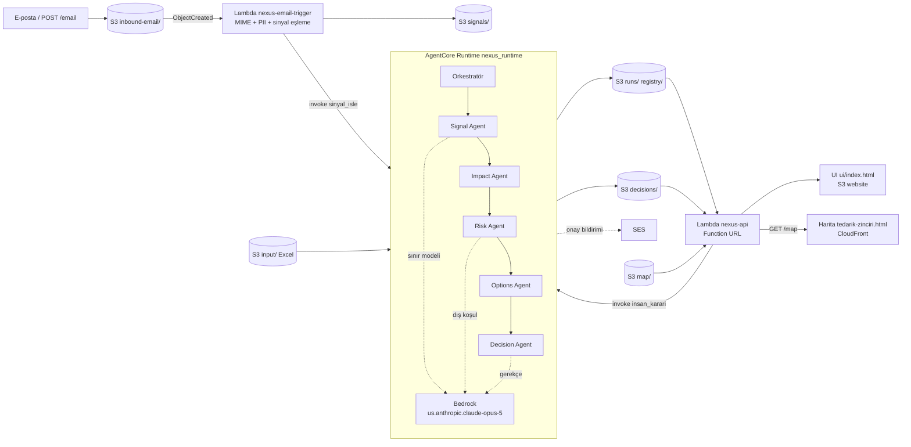

# Design Document

## Overview

NEXUS MVP, e-posta ile gelen tedarik zinciri sinyallerini beş ajanlı bir hat üzerinden işleyerek insan onayına hazır, gerekçeli bir müdahale önerisi üretir. Tasarımın temel ilkeleri:

- **Deterministik çekirdek:** Tüm sayısal hesaplar (kapsama, duruş, maliyet, risk puanı, simülasyon, MCDA, MILP) Python araçlarında yapılır.
- **LLM sınırları:** LLM yalnızca üç sınır modelinde kullanılır (`SignalLLMCikarimi`, `DisKosulBileseni`, `DecisionMetinLLM`); `NEXUS_LLM=off` ile tamamen kapatılabilir.
- **Tek Runtime (D2):** Orkestratör ve beş ajan tek bir AgentCore Runtime içinde paketlenir.
- **Durum S3'te:** Çalıştırmalar, karar kayıtları ve kayıt defteri S3 öneklerinde tutulur.
- **İnsan son sözdür:** Akış en fazla `ONAY_BEKLIYOR` durumuna ilerler; onay `insan_karari` ile verilir.

## Architecture

### Akış durumları

| Durum | Koşul |
|---|---|
| `KAPAT` | Signal Agent sinyali `AYIKLA` olarak işaretledi (gürültü) |
| `IZLEME` | Sevkiyat/malzeme eşleşmedi, etki hesaplanamadı veya risk kademesi Yüksek değil |
| `UYARI` | Uygulanabilir seçenek yok; seçenekler hazırda tutuluyor (O3) |
| `ONAY_BEKLIYOR` | Öneri kartı ve Karar Kaydı hazır, insan onayı bekleniyor |
| `HATA` | Herhangi bir adımda istisna |

## Components and Interfaces

### Sözleşmeler — `src/contracts/schemas.py`
Pydantic v1.1 modelleri; `Sozlesme` tabanı tanımsız alanları reddeder, `Zarf` tüm ajan çıktılarının ortak üst modelidir.

### Veri erişimi — `src/data_access/loader.py`
- `load_data(uri: str | None = None) -> NexusData` — yerel yol veya `s3://` URI
- `load_cached(uri: str | None = None) -> NexusData`
- `NexusData.sheet(ad) -> pd.DataFrame`, `.rows(ad) -> list[dict]`, `.param(ad) -> Any`

### LLM katmanı — `src/common/llm.py`
- `llm_acik() -> bool` — `NEXUS_LLM` kontrolü
- `structured(prompt, output_model, system, tools=None) -> T | None` — Strands Agent ile yapılandırılmış çıktı
- `text(prompt, system) -> str | None`

### Signal Agent — `src/agents/signal/agent.py`
- `run(data, sinyal_no: str, run_id: str) -> SignalOutput`
- Araçlar: `tools/extraction.py` (LLM çıkarımı + yedek), `tools/matching.py` (sevkiyat/malzeme eşleme)

### Impact Agent — `src/agents/impact/agent.py`
- `run(data, signal: SignalOutput, run_id: str, what_if_gun: Optional[float] = None) -> list[ImpactOutput]`
- Araçlar (`tools/calc.py`): `resolve_chain`, `compute_daily_need`, `compute_coverage`, `compute_depletion`, `compute_usable_date`, `compute_gap`, `compute_downtime_cost`, `find_orders_at_risk`, `compute_penalty`, `compute_impact_score`

### Risk Agent — `src/agents/risk/agent.py`
- `run(data, signal: SignalOutput, impacts: list[ImpactOutput], run_id: str, ...) -> RiskOutput`
- Araçlar (`tools/scoring.py`): `find_party`, `choose_party`, `score_performance`, `score_financial`; dış koşul LLM sınır modeli

### Options Agent — `src/agents/options/agent.py`
- `run(data: NexusData, signal, impact: ImpactOutput, risk: Optional[RiskOutput], run_id: str) -> OptionsOutput`
- Alt araçlar: `sourcing/tools.py` (tedarikçi/depo kaynakları), `logistics/tools.py` (rota, süre, maliyet, CO2)

### Decision Agent — `src/agents/decision/agent.py`
- `run(data: NexusData, signal, impact: ImpactOutput, risk: Optional[RiskOutput], options: OptionsOutput, ...) -> DecisionOutput`
- `tools/simulation.py`: `inflows`, `simulate_inventory`
- `tools/scoring.py`: `compute_total_cost`, `holding_cost`, `strategy_risk`, `score_mcda`, `rank_strategies`
- `tools/milp.py`: `solve_milp(p) -> Optional[dict]` (PuLP → SciPy → sayım yedeği)
- `tools/rationale.py`: `allowed_numbers`, `number_test`, `template`; LLM istemi `prompts/gerekce.py`

### Orkestratör — `src/orchestrator/orchestrator.py`, `store.py`
- `sinyal_isle(payload: dict) -> dict` — tam hat, durum makinesi, `_karar_kaydi`, `_bildir` (SES)
- `insan_karari(payload: dict) -> dict` — Karar Kaydı güncelleme
- `toplu_tarama(payload: dict) -> dict` — toplu sinyal işleme
- `Store.put / get / list` — S3 (veya yerel) JSON kalıcılığı

### Runtime girişi — `src/app.py`
`BedrockAgentCoreApp` ile `@app.entrypoint invoke(payload, context)`; `eylem` alanına göre `EYLEMLER` tablosundaki orkestratör fonksiyonuna yönlendirir; bilinmeyen eylemde `HATA` döner.

### E-posta tetikleyici — `src/triggers/email_trigger/handler.py`
- `lambda_handler(event, context)` → `nesne_isle(bucket, key)`
- `mime_ayristir(ham: bytes) -> dict`, `pii_temizle(govde: str) -> str`, `normalize(metin)`
- `sinyal_kaydi_uret(temiz, mime, olusma) -> tuple[str, bool, list[dict]]`
- `agentcore_cagir(payload, oturum=None) -> dict`

### API — `src/api/handler.py`
| Yöntem | Yol | İşlev | Kimlik |
|---|---|---|---|
| GET | `/map` | `harita(kurulus)` | herkese açık |
| GET | `/`, `/health` | sağlık | `x-api-key` |
| GET | `/runs` | `runs_listesi()` | `x-api-key` |
| GET | `/runs/{id}` | `run_detay(run_id)` | `x-api-key` |
| GET | `/decisions` | `kararlar()` | `x-api-key` |
| POST | `/decision` | `karar_ver(govde)` → `insan_karari` | `x-api-key` |
| POST | `/email` | `eposta_yukle(govde)` → `inbound-email/` | `x-api-key` |

### UI ve harita
- `ui/index.html` — çalıştırma listesi, ajan çıktıları, öneri kartı, onay/ret
- `frontend/tedarik-zinciri.html` — tedarik zinciri haritası; `AJANLAR` verisini `GET /map` ucundan okur
- `scripts/build_map_data.py` — `map/` önekine harita verisi üretir

## Data Models

Ayrıntılı tanım: `src/contracts/schemas.py` (v1.1) ve `.kiro/steering/00_ortak_veri_semalari.md`.

| Model | Üreten | Ana içerik |
|---|---|---|
| `Zarf` | tümü | run_id, zaman, uyarılar (`Uyari`), kaynak referansları (`KaynakRef`) |
| `SignalOutput` | Signal | isleme_karari, ilgili_sevkiyat, malzeme, olay tipi, gecikme, ipuçları, `SignalKanit` |
| `RiskOutput` | Risk | `RiskBilesenleri` (`PerformansBileseni`, `DisKosulBileseni`), olasılık, etki, puan, kademe |
| `ImpactOutput` | Impact | kapsama, tükenme, kullanılabilir tarih, açık gün, maliyetler, `RiskAltindakiSiparis` |
| `OptionsOutput` | Options | `Strateji` → `StratejiBileseni` → `KisitKontrolu`; `ElenenKaynak` |
| `DecisionOutput` | Decision | `StratejiKarsilastirma` (`MaliyetKalemleri`, `NormalizePuanlar`, `StratejiSimulasyonu`), `MilpSonucu`, `OneriKarti`, `KararKaydiTaslagi` |
| `KararKaydi` | Orkestratör | olay/risk no, öneri, durum, `InsanKarari` |
| `WhatIfIstegi`, `WhatIfKarsilastirma` | — | şemada tanımlı; MVP'de kullanılmıyor (D7) |

## Error Handling

- **Ajan istisnaları:** `sinyal_isle` istisnayı yakalar, durumu `HATA` ve hata metniyle `runs/` altına yazar.
- **LLM hataları:** `structured`/`text` `None` döndürür; çağıran ajan kural/şablon yedeğine düşer ve `Uyari` ekler.
- **Gerekçe doğrulama:** `number_test` izinli olmayan sayı bulursa şablon gerekçe kullanılır.
- **MILP:** PuLP çözücü bulunamazsa SciPy, o da yoksa sayım yedeği kullanılır.
- **Eksik veri:** Eşleşmeyen sevkiyat/stok `IZLEME` ile, uygulanabilir seçeneksizlik `UYARI` ile sonlanır.
- **API:** Geçersiz anahtar 401, bilinmeyen yol 404, hatalı istek 400, iç hata 500 JSON yanıtı.

## Testing Strategy

Testler `NEXUS_LLM=off` ile deterministik çalışır. Son durum: **43 passed, 1 skipped** (LLM gerektiren test).

| Dosya | Kontrol |
|---|---|
| `tests/contracts/test_koruma.py` | Şema korumaları, tanımsız alan reddi |
| `tests/unit/signal/test_signal_agent.py` | S1 çıkarımı, gürültü ayıklama |
| `tests/unit/impact/test_impact_agent.py` | S1 kapsama, duruş, maliyet, etki puanı |
| `tests/unit/risk/test_risk_agent.py` | Olasılık bileşenleri, kademe |
| `tests/unit/options/test_options_s1.py` | 6 strateji, kısıtlar |
| `tests/unit/decision/test_decision_s1.py` | Simülasyon, sıralama, MILP, S1-HIB önerisi |
| `tests/e2e/test_s1_akis.py` | Uçtan uca S1 → ONAY_BEKLIYOR |
| `tests/test_*.py` (kök) | Önceki `nexus-pipeline` spec'inin `src/nexus` modülleri |

Bulut doğrulaması (S1): `ANALIZ → Yüksek → S1-HIB → ONAY_BEKLIYOR`. Bilinen sapma: S1 olasılığı LLM dış koşul puanı nedeniyle **4,2** (beklenen 4,4); kademe yine **Yüksek**.

## Deployment

| Öğe | Değer |
|---|---|
| Hesap / Bölge | 242872169400 / us-east-1 |
| Model | `us.anthropic.claude-opus-5` (workshop izin listesi) |
| AgentCore Runtime | `nexus_runtime` — direct_code_deploy, PYTHON_3_13, observability açık |
| S3 bucket | `nexus-242872169400-us-east-1` |
| S3 önekleri | `input/`, `inbound-email/` (1 gün yaşam döngüsü), `signals/`, `runs/`, `registry/`, `decisions/`, `map/` |
| Lambda | `nexus-email-trigger` (S3 ObjectCreated `inbound-email/`) |
| Lambda | `nexus-api` (Function URL; `GET /map` hariç `x-api-key`) |
| UI | http://nexus-ui-242872169400-us-east-1.s3-website-us-east-1.amazonaws.com |
| Harita | https://dhqlkgzaubwcj.cloudfront.net/tedarik-zinciri.html |

Betikler: `scripts/deploy_all.sh` (tam dağıtım), `scripts/deploy_frontend.sh` / `setup_frontend_infra.sh` (harita), `scripts/build_map_data.py`, `scripts/demo_reset.py`, `scripts/send_test_email.sh`, `scripts/list_models.sh`.
