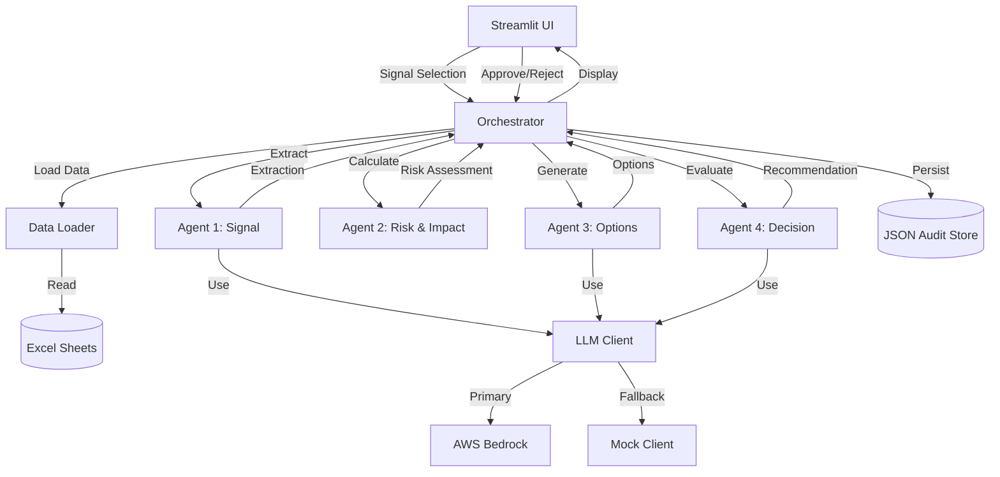
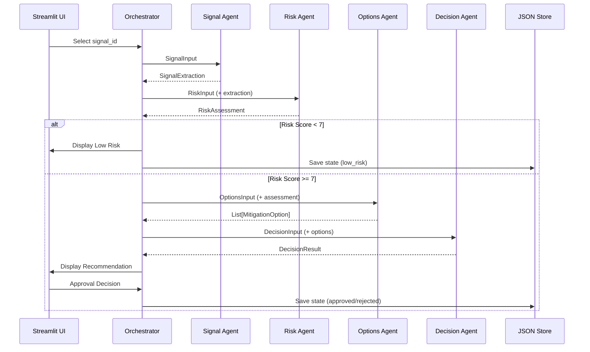

# Design Document: NEXUS Pipeline

## Overview

The NEXUS Pipeline is an automated risk intervention system that processes supply chain disruption signals through a four-agent architecture. The system extracts structured information from raw signals, calculates deterministic risk scores, generates feasible mitigation options, and recommends optimal strategies using multi-criteria evaluation. Each agent operates as a pure function with typed inputs and outputs, coordinated by an orchestrator that manages data flow and state persistence.

### System Context

The pipeline serves pharmaceutical supply chain operations where production continuity and regulatory compliance are critical. It processes signals from multiple sources (port closures, supplier delays, quality issues) and generates actionable recommendations with cost, downtime, CO2, and risk tradeoffs clearly articulated for human approval.

### Design Goals

- **Testability**: Pure function agents enable isolated unit testing
- **Determinism**: Risk calculations use explicit formulas without hidden dependencies
- **Transparency**: All intermediate calculations are logged and auditable
- **Graceful Degradation**: LLM failures fall back to deterministic pattern matching
- **Compliance**: Pharmaceutical qualification constraints are strictly enforced

## Architecture

### High-Level System Architecture



### Agent Data Flow



## Components and Interfaces

### Data Loader (`src/nexus/data_loader.py`)

**Responsibilities:**
- Load Excel file once at startup
- Parse all required sheets into pandas DataFrames
- Provide typed accessor methods for each sheet
- Validate required sheets and columns exist

**Interface:**

```python
class DataLoader:
    def __init__(self, excel_path: str):
        """Load Excel file and validate structure"""
        
    def get_signal(self, signal_id: str) -> SignalRow
    def get_shipment(self, shipment_id: str) -> ShipmentRow
    def get_material(self, material_no: str) -> MaterialRow
    def get_supplier(self, supplier_code: str) -> SupplierRow
    def get_carrier(self, carrier_code: str) -> CarrierRow
    def get_facility(self, facility_code: str) -> FacilityRow
    def get_stock_status(self, material_no: str, facility_code: str) -> StockRow
    def get_production_lines(self, facility_code: str) -> List[ProductionLineRow]
    def get_customer_orders(self, material_no: str) -> List[CustomerOrderRow]
    def get_open_orders(self, material_no: str) -> List[OpenOrderRow]
    def get_supply_sources(self, material_no: str) -> List[SupplySourceRow]
    def get_route_options(self, origin: str, destination: str) -> List[RouteOptionRow]
    def get_parameters() -> ParametersRow
    def get_thresholds() -> ThresholdRow
```

**Validation Rules:**
- Fail on startup if required sheets are missing
- Log warning if optional columns are missing
- Raise KeyError if lookup fails (signal_id, material_no not found)

### Models (`src/nexus/models.py`)

**Purpose:** Pydantic models for type safety and validation

#### Agent Input/Output Models

```python
# Agent 1: Signal Agent
class SignalInput(BaseModel):
    signal_id: str
    signal_text: str
    signal_date: date
    signal_source: str

class SignalExtraction(BaseModel):
    signal_id: str
    event_type: str
    country_region: str
    party_code: Optional[str]
    shipment_id: Optional[str]
    material_no: Optional[str]
    estimated_delay_days: int
    alternative_hints: List[str]
    confidence: float  # 0.0 to 1.0
    extraction_method: Literal["llm", "pattern_match", "not_found"]

# Agent 2: Risk & Impact Agent
class RiskInput(BaseModel):
    signal_id: str
    extraction: SignalExtraction
    # Loaded from data_loader
    
class RiskAssessment(BaseModel):
    signal_id: str
    probability_score: float  # Weighted sum formula
    impact_score: int  # 1-5 scale
    risk_score: float  # probability × impact
    risk_category: Literal["Low", "Medium", "High"]
    available_date: date  # ETA + customs + transport + quality + delay
    stock_coverage_days: float  # current_stock / daily_consumption
    depletion_date: date  # D0 + stock_coverage_days
    downtime_days: float  # max(0, available_day - stock_coverage)
    remaining_buffer: float  # max(0, stock_coverage - available_day)
    downtime_cost: float  # gap × daily_cost + restart_cost
    customer_penalty: float
    total_inaction_cost: float
    at_risk_orders: List[str]  # PO numbers
    justification: str

# Agent 3: Options Agent
class OptionsInput(BaseModel):
    signal_id: str
    extraction: SignalExtraction
    assessment: RiskAssessment

class Arrival(BaseModel):
    day: int  # Day from D0 when shipment arrives
    quantity: float  # Quantity in kg or units

class MitigationOption(BaseModel):
    option_id: str
    option_type: Literal["transfer", "alternative_supplier", "route_change", "expedited", "hybrid", "no_action"]
    details: str  # Human-readable description
    arrivals: List[Arrival]  # List of arrivals (day, quantity) for this option
    action_cost: float  # Direct cost of the mitigation action (logistics, material, QC, inventory carrying)
    co2_kg: float
    risk_score: float  # Residual risk after mitigation
    downtime_days: float  # Calculated via day-by-day simulation
    total_cost: float  # Total cost including downtime, restart, penalty, and action cost
    constraints_satisfied: List[str]
    constraints_violated: List[str]
    feasibility: Literal["Feasible", "Conditional", "NotFeasible"]
    llm_suggestion: str

# Agent 4: Decision Agent
class DecisionInput(BaseModel):
    signal_id: str
    extraction: SignalExtraction
    assessment: RiskAssessment
    options: List[MitigationOption]

class RankedOption(BaseModel):
    option: MitigationOption
    normalized_cost: float
    normalized_downtime: float
    normalized_co2: float
    normalized_risk: float
    ckkv_score: float
    rank: int

class DecisionResult(BaseModel):
    signal_id: str
    all_options_ranked: List[RankedOption]
    recommended_option: RankedOption
    justification: str  # LLM-generated explanation
```

#### Data Row Models

```python
class SignalRow(BaseModel):
    sinyal_no: str  # "Sinyal No"
    ham_metin: str  # "Ham Metin (LLM Girdisi)"
    yayin_zamani: datetime  # "Yayın Zamanı"
    kaynak_kodu: str  # "Kaynak Kodu"
    kaynak_adi: str  # "Kaynak Adı"
    kategori: str  # "Kategori"

class ShipmentRow(BaseModel):
    sevkiyat_no: str  # "Sevkiyat No"
    takip_no: Optional[str]  # "Takip No"
    po_no: str  # "PO No"
    malzeme_no: str  # "Malzeme No"
    miktar: float  # "Miktar"
    birim: str  # "Birim"
    tedarikci_no: str  # "Tedarikçi No"
    tasiyici_no: str  # "Taşıyıcı No"
    sevkiyat_tarihi: date  # "Sevkiyat Tarihi"
    eta: date  # "ETA"
    gemi_adi: Optional[str]  # "Gemi Adı"

class MaterialRow(BaseModel):
    malzeme_no: str  # "Malzeme No"
    malzeme_adi: str  # "Malzeme Adı"
    kategori: str  # "Kategori"
    min_siparis_miktari: float  # "Min Sipariş Miktarı"
    birim: str  # "Birim"

class StockRow(BaseModel):
    stok_anahtari: str  # "Stok Anahtarı" (Tesis|Malzeme)
    malzeme_no: str  # "Malzeme No"
    tesis_kodu: str  # "Tesis Kodu"
    mevcut_stok: float  # "Mevcut Stok"
    gunluk_tuketim: float  # "Günlük Tüketim"
    emniyet_stoku: float  # "Emniyet Stoku"

class SupplierRow(BaseModel):
    tedarikci_no: str  # "Tedarikçi No"
    tedarikci_adi: str  # "Tedarikçi Adı"
    ulke: str  # "Ülke"
    finansal_not: str  # "Finansal Not"
    
class SupplySourceRow(BaseModel):
    kaynak_anahtari: str  # "Kaynak Anahtarı" (Malzeme|Tedarikçi)
    malzeme_no: str  # "Malzeme No"
    tedarikci_no: str  # "Tedarikçi No"
    ana_kaynak_mi: bool  # "Ana Kaynak mı?"
    kalifikasyon_durumu: str  # "Kalifikasyon Durumu"
    kalifikasyon_suresi_gun: int  # "Kalifikasyon Süresi (gün)"
    standart_tedarik_suresi_gun: int  # "Standart Tedarik Süresi (gün)"
    birim_fiyat_usd: float  # "Birim Fiyat (USD)"
    spot_moq: float  # "Spot MOQ (birim)"

class ProductionLineRow(BaseModel):
    hat_kodu: str  # "Hat Kodu"
    tesis_kodu: str  # "Tesis Kodu"
    kritik_malzeme_no: str  # "Kritik Malzeme No"
    gunluk_malzeme_ihtiyaci: float  # "Günlük Malzeme İhtiyacı"
    gunluk_durus_maliyeti: float  # "Günlük Duruş Maliyeti (TRY)"
    yeniden_baslatma_maliyeti: float  # "Yeniden Başlatma Maliyeti (TRY)"

class CustomerOrderRow(BaseModel):
    siparis_no: str  # "Sipariş No"
    mamul_no: str  # "Mamul No"
    miktar: float  # "Miktar"
    teslimat_tarihi: date  # "Teslimat Tarihi"
    ceza_maddesi: float  # "Ceza Maddesi" (penalty amount)

class ParametersRow(BaseModel):
    analiz_referans_tarihi: date  # D0 - "AnalizTarihi" column
    usdtry: float  # 45.9 - "USDTRY" column
    eurtry: float  # 47.4 - "EURTRY" column
    eurusd: float  # 1.03268 - "EURUSD" column
    stok_tasima_orani: float  # 0.30 - "StokTasimaOrani" (annual inventory carrying rate)
    planlama_tamponu: int  # 2 days - "PlanlamaTambonu"
    koruma_ufku: int  # 7 days - "KorumaUfku" (transfer protection window)
    qc_test_maliyeti: float  # 25000 TRY - "QCTestMaliyeti"
    esik_yuksek: float  # 15.0 - "EsikYuksek"
    esik_orta: float  # 7.0 - "EsikOrta"
    olasilik_agirlik_sinyal: float  # 0.4 - Signal weight in probability
    olasilik_agirlik_performans: float  # 0.3 - Performance weight
    olasilik_agirlik_dis: float  # 0.2 - External condition weight
    olasilik_agirlik_finansal: float  # 0.1 - Financial weight
    ckkv_agirlik_maliyet: float  # 0.45 - Cost weight in CKKV
    ckkv_agirlik_durusma: float  # 0.30 - Downtime weight
    ckkv_agirlik_co2: float  # 0.10 - CO2 weight
    ckkv_agirlik_risk: float  # 0.15 - Risk weight
    
# NOTE: Daily downtime cost and restart cost are NOT in Parametreler sheet
# They come from Uretim_Hatlari sheet (per production line):
#   - gunluk_durus_maliyeti: Daily downtime cost (TRY)
#   - yeniden_baslatma_maliyeti: One-time restart cost (TRY)
# Customer penalty base is NOT a fixed parameter
# It is calculated as sum of ceza_maddesi from Musteri_Siparisleri for at-risk orders
```

### Agent 1: Signal Agent (`src/nexus/agents/signal_agent.py`)

**Purpose:** Extract structured information from raw signal text

**Function Signature:**

```python
def process_signal(
    input_data: SignalInput,
    llm_client: LLMClient,
    data_loader: DataLoader
) -> SignalExtraction:
    """Extract structured fields from signal text"""
```

**Algorithm:**

1. **LLM Extraction** (Primary):
   - Construct prompt with signal text and extraction schema
   - Call Bedrock Claude with JSON mode
   - Parse structured response
   - If successful and confidence > 0.5, return extraction

2. **Pattern Matching** (Fallback):
   - Regex patterns for shipment IDs: `[A-Z]{3}-[A-Z]{3}-\d{2}-\d{4}`
   - Keyword matching for event types (port, closure, delay, quality, power)
   - Country/region extraction via gazetteer
   - Set confidence based on match quality
   - Set extraction_method = "pattern_match"

3. **Mock Data Lookup** (Test/Demo):
   - If signal_id exists in mock data, return pre-recorded extraction
   - Used when LLM unavailable and no pattern match

**Error Handling:**
- LLM timeout: fall back to pattern matching
- Malformed JSON: log warning, use pattern matching
- Low confidence (< 0.5): flag for manual review in output

### Agent 2: Risk & Impact Agent (`src/nexus/agents/risk_impact_agent.py`)

**Purpose:** Calculate deterministic risk scores and financial impact

**Function Signature:**

```python
def calculate_risk_assessment(
    input_data: RiskInput,
    data_loader: DataLoader,
    parameters: ParametersRow
) -> RiskAssessment:
    """Calculate risk score, stock coverage, downtime, and costs"""
```

**Algorithms:**

#### Probability Calculation

```python
# Requirement 2: Weighted probability formula
probability = (
    0.4 × signal_reliability +
    0.3 × performance_score +
    0.2 × external_factor_score +
    0.1 × financial_score
)
```

**Component Sources:**
- `signal_reliability`: From Risk_Kaynaklari sheet, matched by signal source
- `performance_score`: From Tedarikciler sheet, supplier historical performance
- `external_factor_score`: From extraction (country risk, event severity)
- `financial_score`: From Tedarikciler sheet, supplier financial health

#### Stock Coverage Calculation

```python
# Requirement 3: Stock coverage formula
stock_coverage_days = current_stock_kg / daily_consumption_kg

# Handle edge cases
if daily_consumption_kg == 0:
    stock_coverage_days = float('inf')
    log_warning("Zero daily consumption for material")
```

#### Risk Score and Classification

```python
# Requirement 4: Risk score and category
risk_score = probability × impact

if risk_score >= 15.0:  # FIXED: 15 is High, not Medium
    risk_category = "High"
elif risk_score >= 7.0:
    risk_category = "Medium"
else:
    risk_category = "Low"
```

**Impact Score Assignment (Requirement 6):**

```python
def calculate_impact_score(
    downtime_gap: float,
    no_action_cost: float,
    remaining_buffer: float,
    safety_stock_days: int
) -> int:
    if downtime_gap > 0:
        if no_action_cost >= 2_000_000:
            return 5
        elif no_action_cost >= 500_000:
            return 4
        else:
            return 3
    else:  # downtime_gap == 0
        if remaining_buffer < safety_stock_days:
            return 2
        else:
            return 1
```

#### Available Date Calculation

```python
# Requirement 5: Available date formula
available_day = (
    current_eta_date +
    customs_days +
    inland_transport_days +
    quality_approval_days +
    estimated_delay_days  # from signal extraction
)
```

#### Downtime Gap and Buffer

```python
# Requirement 5: Downtime and buffer calculations
D0 = parameters.analiz_referans_tarihi
depletion_date = D0 + timedelta(days=stock_coverage_days)

# Days from D0 to available_date
available_days_from_d0 = (available_date - D0).days

# Downtime gap: how many days production stops
downtime_gap = max(0, available_days_from_d0 - stock_coverage_days)

# Remaining buffer: safety margin
remaining_buffer = max(0, stock_coverage_days - available_days_from_d0)
```

#### Financial Impact

```python
# Requirement 6: Downtime cost calculation
# Daily downtime cost and restart cost come from Uretim_Hatlari sheet (per production line)
production_line = data_loader.get_production_line_for_material(material_no, facility_code)
daily_downtime_cost = production_line.gunluk_durus_maliyeti
restart_cost = production_line.yeniden_baslatma_maliyeti

if downtime_gap > 0:
    downtime_cost = downtime_gap * daily_downtime_cost + restart_cost
    
    # Customer penalty base = sum of penalties from at-risk orders
    at_risk_orders = identify_at_risk_orders(material_no, depletion_date, available_date)
    customer_penalty_base = sum(order.ceza_maddesi for order in at_risk_orders)
    
    # Prorate penalty by downtime
    customer_penalty = customer_penalty_base * min(1.0, downtime_gap / no_action_downtime)
else:
    downtime_cost = 0
    customer_penalty = 0

total_inaction_cost = downtime_cost + customer_penalty
```

**At-Risk Orders Identification:**

```python
# Query Musteri_Siparisleri sheet for material_no (customer orders using this material)
# For each customer order:
#   required_production_date = order.teslimat_tarihi - shipping_days
#   order is "Risk Altında" if: depletion_date <= required_production_date <= available_date
#   This means production must start by required_production_date, but material won't arrive until available_date
# Return list of order numbers (siparis_no) that fall in this window
# Calculate customer penalty base = sum of order.ceza_maddesi (penalty amounts) for all at-risk orders
```

### Agent 3: Options Agent (`src/nexus/agents/options_agent.py`)

**Purpose:** Generate feasible mitigation options with constraint validation

**Function Signature:**

```python
def generate_mitigation_options(
    input_data: OptionsInput,
    llm_client: LLMClient,
    data_loader: DataLoader,
    parameters: ParametersRow
) -> List[MitigationOption]:
    """Generate and validate mitigation options"""
```

**Option Generation Strategy:**

#### Transfer Options (Requirement 7.1)

```python
# Query Stok_Durumu for material_no at other facilities
# Filter: mevcut_stok > min_siparis_miktari

# CRITICAL: Transfer Protection Constraint (Formuller #38)
# Source facility must retain safety stock + KorumaUfku days of consumption
# Calculate:
#   - reserve_qty = source_facility.emniyet_stoku 
#                 + (parameters.koruma_ufku * source_facility.gunluk_tuketim)
#   - transferable_qty = source_facility.mevcut_stok - reserve_qty
#   - Only generate transfer if transferable_qty > 0
#   - cost: internal transfer rate × quantity × distance
#   - available_days: internal_transport_days
#   - co2_kg: truck_emission_factor × distance × quantity
#   - risk_score: low (internal supply chain)
#   - arrivals: [Arrival(day=available_days, quantity=transferable_qty)]

# Constraint validation:
#   - transfer_protection: source retains emniyet_stoku + (koruma_ufku × gunluk_tuketim)
#   - capacity: destination facility has storage
#   - routing: transport route exists
```

#### Alternative Supplier Options (Requirement 7.2, 7.3)

```python
# Query Tedarik_Kaynaklari for material_no
# Filter out current supplier

# CRITICAL: Pharmaceutical qualification check (Req 8.1)
# Qualification status is in Tedarik_Kaynaklari.kalifikasyon_durumu per (material, supplier) pair
# Only use suppliers with kalifikasyon_durumu == "Onaylı"
# NOTE: Qualification is NOT on Tedarikciler or Malzemeler sheets - it's per material×supplier

# Calculate option ready day (Formuller #27):
#   available_days = standart_tedarik_suresi_gun 
#                  + (kalifikasyon_suresi_gun if kalifikasyon_durumu != "Onaylı") 
#                  + route_transit_days + customs_days + quality_approval_days

# Calculate:
#   - action_cost: (supplier.birim_fiyat_usd × USDTRY × quantity) + shipping + QC_tests + inventory_carrying
#   - available_days: per formula above
#   - co2_kg: shipping_emission_factor × distance
#   - risk_score: supplier.risk_rating
#   - arrivals: [Arrival(day=available_days, quantity=order_quantity)]

# Constraint validation:
#   - qualification: kalifikasyon_durumu == "Onaylı" for this material×supplier pair
#   - moq: quantity >= spot_moq
#   - capacity: quantity <= ek_uretim_kapasitesi × available_days
```

#### Route Change Options (Requirement 7.4)

```python
# Query Rota_Secenekleri for alternative routes
# Calculate cost and time deltas
# Update ETA based on new route
```

#### Expedited Shipping Options (Requirement 7.5)

```python
# Air freight calculation
# Calculate:
#   - quantity: full shipment or critical portion
#   - action_cost: air_freight_rate × quantity × distance
#   - available_days: 2 (air transit) + customs_expedited
#   - co2_kg: air_emission_factor × distance × quantity (high)
#   - risk_score: low (fast, reliable)
#   - arrivals: [Arrival(day=available_days, quantity=air_qty)]

# Constraint violations:
#   - cost: expensive
#   - co2: high emissions
```

#### Hybrid Options (Requirement 7.6)

```python
# Combine transfer + expedited air freight
# Goal: achieve zero downtime with acceptable cost

# Calculate air quantity (Req 7.6):
hybrid_air_qty = (
    (main_shipment_available_day + 2) × daily_consumption
    - current_stock
    - transfer_qty
)
# Round up to MOQ
hybrid_air_qty = ceil(hybrid_air_qty / moq) × moq

# Calculate:
#   - action_cost: transfer_cost + (air_qty × air_rate) + inventory_carrying + QC_tests
#   - arrivals: [Arrival(day=transfer_days, quantity=transfer_qty),
#                Arrival(day=air_days, quantity=air_qty),
#                Arrival(day=main_shipment_days, quantity=main_qty)]
#   - co2_kg: transfer_co2 + air_co2
#   - downtime_days: 0 (by design, verified via simulation)
#   - total_cost: calculated via full formula (downtime + restart + penalty + action_cost)

# Constraint satisfaction:
#   - downtime_zero: explicitly satisfied
```

#### No-Action Baseline

```python
# Always include no-action option for comparison
# CRITICAL: Total cost for no-action must equal the inaction cost (NOT zero)

# Calculate no-action total cost (Formuller #41-42):
no_action_downtime_days = assessment.downtime_days
no_action_total_cost = (
    no_action_downtime_days * daily_downtime_cost +
    (restart_cost if no_action_downtime_days > 0 else 0) +
    customer_penalty_base  # Full penalty for at-risk orders (no proration for no_action)
)

# VERIFICATION: no_action_total_cost should equal assessment.total_inaction_cost (~2,741,018 TRY for R-01)

MitigationOption(
    option_id="no_action",
    option_type="no_action",
    details="Take no action - wait for original shipment",
    arrivals=[Arrival(day=original_eta_days, quantity=original_shipment_qty)],
    action_cost=0,  # No mitigation action cost
    co2_kg=0,  # No additional emissions
    risk_score=assessment.risk_score,  # Original risk
    downtime_days=assessment.downtime_days,  # Original downtime from assessment
    total_cost=no_action_total_cost,  # Must equal inaction cost
    feasibility="Feasible"
)
```

**Feasibility Classification (Requirement 8.4, 8.5):**

```python
def classify_feasibility(option: MitigationOption) -> str:
    if len(option.constraints_violated) == 0:
        return "Feasible"
    elif option.constraints_violated in [["cost"], ["co2"]]:
        # Soft constraints
        return "Conditional"
    else:
        # Hard constraints (qualification, capacity)
        return "NotFeasible"
```

**LLM Integration:**

```python
# For each option, call LLM to generate suggestion
# Prompt includes:
#   - Option details
#   - Cost/time/CO2 tradeoffs
#   - Constraint status
# Response: 1-2 sentence evaluation
# Fallback: deterministic template if LLM unavailable
```

### Agent 4: Decision Agent (`src/nexus/agents/decision_agent.py`)

**Purpose:** Evaluate options with multi-criteria scoring and recommend strategy

**Function Signature:**

```python
def evaluate_and_recommend(
    input_data: DecisionInput,
    llm_client: LLMClient,
    parameters: ParametersRow
) -> DecisionResult:
    """Rank options by CKKV score and recommend best strategy"""
```

**Algorithm:**

#### Step 1: Downtime Calculation via Day-by-Day Simulation

For each option, calculate precise downtime using daily inventory simulation:

```python
def simulate_downtime(
    option: MitigationOption,
    current_stock: float,
    daily_consumption: float,
    main_shipment_available_day: int,
    parameters: ParametersRow
) -> float:
    """
    Simulate daily stock levels to calculate partial downtime
    Returns: downtime in fractional days
    
    Evaluation horizon: from D0 to main_shipment_available_day (fixed endpoint)
    Main shipment is included in every option's arrivals schedule
    """
    D0 = parameters.analiz_referans_tarihi
    inventory = current_stock
    downtime_hours = 0
    
    # Sort all arrivals by day
    arrivals_schedule = sorted(option.arrivals, key=lambda a: a.day)
    
    # Simulate from day 0 to main shipment arrival (evaluation horizon)
    for day in range(main_shipment_available_day + 1):
        # Start-of-day arrivals
        for arrival in arrivals_schedule:
            if arrival.day == day:
                inventory += arrival.quantity
        
        # Intraday consumption
        consumption_today = daily_consumption
        
        if inventory >= consumption_today:
            # Normal operation
            inventory -= consumption_today
        else:
            # Partial downtime
            hours_operating = (inventory / consumption_today) * 24
            downtime_hours += (24 - hours_operating)
            inventory = 0
    
    return downtime_hours / 24.0  # Convert to days
```

**Key Features:**
- **Start-of-day arrivals**: Shipments arrive before consumption starts
- **Intraday consumption**: Linear consumption throughout day
- **Partial downtime**: If stock runs out mid-day, calculate fractional downtime
- **Multiple arrivals**: Hybrid options have transfer + air + main shipment arrivals
- **Fixed horizon**: Simulate until main shipment available day (not until recovery)
- **No early termination**: Removed "inventory > 2× daily_consumption → break" check

#### Step 2: Total Cost Calculation for Each Option

For each option, calculate the full total cost (Formuller #41-42):

```python
def calculate_total_cost(
    option: MitigationOption,
    daily_downtime_cost: float,
    restart_cost: float,
    customer_penalty_base: float,
    no_action_downtime: float
) -> float:
    """
    Calculate total cost including downtime, restart, penalty, and action cost
    
    Total = simulated_downtime_days × daily_downtime_cost
          + one_time_restart_cost (only if downtime > 0)
          + no_action_penalty × min(1, option_downtime / no_action_downtime)
          + action_cost (logistics + extra_material + QC_tests + inventory_carrying)
    
    CRITICAL: For no_action option, this must equal ~2,741,018 TRY inaction cost
    """
    # Downtime cost component
    if option.downtime_days > 0:
        downtime_cost = option.downtime_days * daily_downtime_cost
        restart_cost_component = restart_cost
    else:
        downtime_cost = 0
        restart_cost_component = 0
    
    # Customer penalty (prorated by downtime relative to no-action)
    if no_action_downtime > 0:
        penalty = customer_penalty_base * min(1.0, option.downtime_days / no_action_downtime)
    else:
        penalty = 0
    
    # Total cost formula (Formuller #41-42)
    total_cost = (
        downtime_cost +
        restart_cost_component +
        penalty +
        option.action_cost  # Logistics + material + QC + inventory carrying
    )
    
    return total_cost

# Apply to ALL options including no_action
for option in options:
    option.total_cost = calculate_total_cost(
        option,
        daily_downtime_cost,
        restart_cost,
        customer_penalty_base,
        no_action_downtime
    )
```

**CRITICAL NOTES:**
- **No-action total cost**: Must equal the inaction cost (~2,741,018 TRY), NOT zero
- **Action cost components**: Logistics + extra material cost + QC tests + inventory carrying cost
- **CKKV normalization**: Uses total_cost (not action_cost) for cost criterion
- **Penalty proration**: Mitigation options get prorated penalty, no_action gets full penalty

#### Step 3: Min-Max Normalization Across All Options

```python
# Requirement 9: Min-max normalization
# For each criterion, find best and worst across ALL options

# Cost (lower is better) - use TOTAL cost
costs = [opt.total_cost for opt in options]
best_cost = min(costs)
worst_cost = max(costs)

for opt in options:
    if worst_cost == best_cost:
        opt.normalized_cost = 1.0  # Requirement 9.5
    else:
        opt.normalized_cost = (worst_cost - opt.total_cost) / (worst_cost - best_cost)

# Downtime (lower is better)
downtimes = [opt.downtime_days for opt in options]
best_downtime = min(downtimes)
worst_downtime = max(downtimes)

for opt in options:
    if worst_downtime == best_downtime:
        opt.normalized_downtime = 1.0
    else:
        opt.normalized_downtime = (worst_downtime - opt.downtime_days) / (worst_downtime - best_downtime)

# CO2 (lower is better)
co2s = [opt.co2_kg for opt in options]
best_co2 = min(co2s)
worst_co2 = max(co2s)

for opt in options:
    if worst_co2 == best_co2:
        opt.normalized_co2 = 1.0
    else:
        opt.normalized_co2 = (worst_co2 - opt.co2_kg) / (worst_co2 - best_co2)

# Risk (lower is better)
risks = [opt.risk_score for opt in options]
best_risk = min(risks)
worst_risk = max(risks)

for opt in options:
    if worst_risk == best_risk:
        opt.normalized_risk = 1.0
    else:
        opt.normalized_risk = (worst_risk - opt.risk_score) / (worst_risk - best_risk)
```

#### Step 4: CKKV Score Calculation

```python
# Requirement 9.6: Weighted CKKV score
for opt in options:
    opt.ckkv_score = (
        parameters.ckkv_agirlik_maliyet * opt.normalized_cost +
        parameters.ckkv_agirlik_durusma * opt.normalized_downtime +
        parameters.ckkv_agirlik_co2 * opt.normalized_co2 +
        parameters.ckkv_agirlik_risk * opt.normalized_risk
    )
```

**Weights (from Parameters sheet):**
- Cost: 0.45
- Downtime: 0.30
- CO2: 0.10
- Risk: 0.15

#### Step 5: Ranking and Recommendation

```python
# Requirement 9.7: Rank by CKKV score (higher is better)
ranked_options = sorted(options, key=lambda x: x.ckkv_score, reverse=True)

for rank, opt in enumerate(ranked_options, start=1):
    opt.rank = rank

# Requirement 10.1: Select highest scoring option
recommended = ranked_options[0]
```

#### Step 6: Justification Generation

```python
# Requirement 10.2: LLM-generated justification
prompt = f"""
Generate a 2-3 sentence justification for recommending the following mitigation strategy:

Option: {recommended.details}
Total Cost: {recommended.total_cost:,.0f} TRY
Downtime: {recommended.downtime_days:.2f} days
CO2: {recommended.co2_kg:.0f} kg
Risk Score: {recommended.risk_score:.1f}
CKKV Score: {recommended.ckkv_score:.3f} (rank 1 of {len(ranked_options)})

Explain why this option balances cost, downtime, sustainability, and risk optimally.
"""

justification = llm_client.generate(prompt)

# Fallback if LLM unavailable
if not justification:
    justification = (
        f"Recommend {recommended.option_type} option: {recommended.details}. "
        f"CKKV score {recommended.ckkv_score:.3f} ranks highest, "
        f"balancing total cost ({recommended.total_cost:,.0f} TRY), "
        f"downtime ({recommended.downtime_days:.2f} days), "
        f"CO2 ({recommended.co2_kg:.0f} kg), and risk optimally."
    )
```

### Orchestrator (`src/nexus/orchestrator.py`)

**Purpose:** Coordinate agent execution and manage pipeline state

**Function Signature:**

```python
class PipelineOrchestrator:
    def __init__(
        self,
        data_loader: DataLoader,
        llm_client: LLMClient,
        parameters: ParametersRow
    ):
        self.data_loader = data_loader
        self.llm_client = llm_client
        self.parameters = parameters
    
    def run_pipeline(self, signal_id: str) -> PipelineState:
        """Execute full pipeline for given signal"""
```

**Execution Flow:**

```python
def run_pipeline(self, signal_id: str) -> PipelineState:
    state = PipelineState(signal_id=signal_id)
    
    try:
        # Step 1: Signal extraction
        signal_data = self.data_loader.get_signal(signal_id)
        signal_input = SignalInput(
            signal_id=signal_id,
            signal_text=signal_data.sinyal_metni,
            signal_date=signal_data.sinyal_tarihi,
            signal_source=signal_data.sinyal_kaynagi
        )
        state.agent_1_output = process_signal(
            signal_input, self.llm_client, self.data_loader
        )
        
        # Step 2: Risk assessment
        risk_input = RiskInput(
            signal_id=signal_id,
            extraction=state.agent_1_output
        )
        state.agent_2_output = calculate_risk_assessment(
            risk_input, self.data_loader, self.parameters
        )
        
        # Early exit for low risk (Requirement 12)
        if state.agent_2_output.risk_category == "Low":
            state.status = "low_risk"
            self._save_state(state)
            return state
        
        # Step 3: Generate options
        options_input = OptionsInput(
            signal_id=signal_id,
            extraction=state.agent_1_output,
            assessment=state.agent_2_output
        )
        state.agent_3_output = generate_mitigation_options(
            options_input, self.llm_client, self.data_loader, self.parameters
        )
        
        # Step 4: Evaluate and recommend
        decision_input = DecisionInput(
            signal_id=signal_id,
            extraction=state.agent_1_output,
            assessment=state.agent_2_output,
            options=state.agent_3_output
        )
        state.agent_4_output = evaluate_and_recommend(
            decision_input, self.llm_client, self.parameters
        )
        
        state.status = "completed"
        return state
        
    except Exception as e:
        state.status = "error"
        state.error_message = str(e)
        self._save_state(state)
        raise
```

**State Persistence:**

```python
def _save_state(self, state: PipelineState):
    """Save pipeline state to JSON (Requirement 18)"""
    timestamp = datetime.now().isoformat()
    filename = f"decisions/{state.signal_id}_{timestamp}.json"
    
    state_dict = {
        "signal_id": state.signal_id,
        "timestamp": timestamp,
        "status": state.status,
        "agent_1_output": state.agent_1_output.dict() if state.agent_1_output else None,
        "agent_2_output": state.agent_2_output.dict() if state.agent_2_output else None,
        "agent_3_output": [opt.dict() for opt in state.agent_3_output] if state.agent_3_output else None,
        "agent_4_output": state.agent_4_output.dict() if state.agent_4_output else None,
        "approval_decision": state.approval_decision,
        "approver_identity": state.approver_identity,
        "error_message": state.error_message
    }
    
    with open(filename, 'w', encoding='utf-8') as f:
        json.dump(state_dict, f, indent=2, ensure_ascii=False, default=str)
```

### LLM Client (`src/nexus/llm_client.py`)

**Purpose:** Abstract LLM calls with Bedrock + Mock fallback

**Interface:**

```python
class LLMClient(ABC):
    @abstractmethod
    def generate(self, prompt: str, json_mode: bool = False) -> str:
        """Generate text or JSON response"""
        
class BedrockClient(LLMClient):
    def __init__(self, model_id: str = "anthropic.claude-3-sonnet-20240229-v1:0"):
        self.client = boto3.client('bedrock-runtime')
        self.model_id = model_id
    
    def generate(self, prompt: str, json_mode: bool = False) -> str:
        try:
            # Construct Bedrock request
            request_body = {
                "anthropic_version": "bedrock-2023-05-31",
                "messages": [{"role": "user", "content": prompt}],
                "max_tokens": 2000,
                "temperature": 0.0
            }
            
            response = self.client.invoke_model(
                modelId=self.model_id,
                body=json.dumps(request_body)
            )
            
            response_body = json.loads(response['body'].read())
            return response_body['content'][0]['text']
            
        except Exception as e:
            logging.warning(f"Bedrock call failed: {e}")
            raise

class MockClient(LLMClient):
    def __init__(self, mock_data: dict):
        self.mock_data = mock_data
    
    def generate(self, prompt: str, json_mode: bool = False) -> str:
        # Extract signal_id from prompt
        signal_id = self._extract_signal_id(prompt)
        
        if signal_id in self.mock_data:
            return json.dumps(self.mock_data[signal_id])
        else:
            return json.dumps({"error": "No mock data available"})

class FallbackLLMClient(LLMClient):
    """Primary-fallback pattern (Requirement 13)"""
    def __init__(self, primary: LLMClient, fallback: LLMClient):
        self.primary = primary
        self.fallback = fallback
    
    def generate(self, prompt: str, json_mode: bool = False) -> str:
        try:
            return self.primary.generate(prompt, json_mode)
        except Exception as e:
            logging.warning(f"Primary LLM failed, using fallback: {e}")
            return self.fallback.generate(prompt, json_mode)
```

### Streamlit App (`src/nexus/app.py`)

**Purpose:** Human approval UI with step-by-step visualization

**UI Flow:**

```python
def main():
    st.title("NEXUS Risk Intervention Pipeline")
    
    # Step 1: Signal selection (Requirement 11.1)
    data_loader = initialize_data_loader()
    signal_ids = data_loader.get_all_signal_ids()
    selected_signal = st.selectbox("Select Signal", signal_ids)
    
    if st.button("Analyze Signal"):
        orchestrator = initialize_orchestrator()
        
        with st.spinner("Processing..."):
            state = orchestrator.run_pipeline(selected_signal)
        
        # Display results
        display_pipeline_state(state)

def display_pipeline_state(state: PipelineState):
    # Agent 1: Signal Extraction
    with st.expander("Agent 1: Signal Extraction", expanded=True):
        st.json(state.agent_1_output.dict())
    
    # Agent 2: Risk Assessment
    with st.expander("Agent 2: Risk Assessment", expanded=True):
        st.metric("Risk Score", f"{state.agent_2_output.risk_score:.1f}")
        st.metric("Risk Category", state.agent_2_output.risk_category)
        st.metric("Stock Coverage", f"{state.agent_2_output.stock_coverage_days:.2f} days")
        st.metric("Downtime", f"{state.agent_2_output.downtime_days:.2f} days")
        st.metric("Total Cost (No Action)", f"{state.agent_2_output.total_inaction_cost:,.0f} TRY")
    
    # Early exit if low risk
    if state.status == "low_risk":
        st.info("Low risk signal - monitoring only")
        return
    
    # Agent 3: Mitigation Options
    with st.expander("Agent 3: Mitigation Options", expanded=True):
        for opt in state.agent_3_output:
            st.markdown(f"**{opt.option_type}**: {opt.details}")
            st.text(f"Cost: {opt.cost:,.0f} TRY | Downtime: {opt.downtime_days:.2f} days")
    
    # Agent 4: Recommendation
    with st.expander("Agent 4: Decision", expanded=True):
        st.subheader("Strategy Comparison")
        
        # Create comparison table
        df = pd.DataFrame([
            {
                "Rank": opt.rank,
                "Option": opt.option.option_type,
                "Cost (TRY)": f"{opt.option.cost:,.0f}",
                "Downtime (days)": f"{opt.option.downtime_days:.2f}",
                "CO2 (kg)": f"{opt.option.co2_kg:.0f}",
                "CKKV Score": f"{opt.ckkv_score:.3f}"
            }
            for opt in state.agent_4_output.all_options_ranked
        ])
        st.dataframe(df)
        
        # Recommended strategy
        st.success("Recommended Strategy")
        recommended = state.agent_4_output.recommended_option
        st.markdown(f"**{recommended.option.details}**")
        st.info(state.agent_4_output.justification)
    
    # Approval buttons (Requirement 11.2, 11.3, 11.4)
    col1, col2 = st.columns(2)
    
    with col1:
        if st.button("✅ Approve", type="primary"):
            approve_decision(state, approver="current_user")
            st.success("Decision approved and saved")
    
    with col2:
        if st.button("❌ Reject"):
            reject_decision(state, approver="current_user")
            st.warning("Decision rejected")
```

## Data Models

### Complete Type Hierarchy

```
PipelineState
├── signal_id: str
├── agent_1_output: SignalExtraction
├── agent_2_output: RiskAssessment
├── agent_3_output: List[MitigationOption]
├── agent_4_output: DecisionResult
├── status: Literal["pending", "low_risk", "completed", "error"]
├── approval_decision: Optional[Literal["approved", "rejected"]]
├── approver_identity: Optional[str]
└── error_message: Optional[str]

SignalExtraction
├── signal_id: str
├── event_type: str
├── country_region: str
├── party_code: Optional[str]
├── shipment_id: Optional[str]
├── material_no: Optional[str]
├── estimated_delay_days: int
├── alternative_hints: List[str]
├── confidence: float
└── extraction_method: Literal["llm", "pattern_match", "not_found"]

RiskAssessment
├── signal_id: str
├── probability_score: float
├── impact_score: int
├── risk_score: float
├── risk_category: Literal["Low", "Medium", "High"]
├── available_date: date
├── stock_coverage_days: float
├── depletion_date: date
├── downtime_days: float
├── remaining_buffer: float
├── downtime_cost: float
├── customer_penalty: float
├── total_inaction_cost: float
├── at_risk_orders: List[str]
└── justification: str

MitigationOption
├── option_id: str
├── option_type: Literal["transfer", "alternative_supplier", "route_change", "expedited", "hybrid", "no_action"]
├── details: str
├── available_days_from_now: float
├── cost: float
├── co2_kg: float
├── risk_score: float
├── downtime_days: float
├── constraints_satisfied: List[str]
├── constraints_violated: List[str]
├── feasibility: Literal["Feasible", "Conditional", "NotFeasible"]
└── llm_suggestion: str

RankedOption
├── option: MitigationOption
├── normalized_cost: float
├── normalized_downtime: float
├── normalized_co2: float
├── normalized_risk: float
├── ckkv_score: float
└── rank: int

DecisionResult
├── signal_id: str
├── all_options_ranked: List[RankedOption]
├── recommended_option: RankedOption
└── justification: str
```

## Correctness Properties

*A property is a characteristic or behavior that should hold true across all valid executions of a system-essentially, a formal statement about what the system should do. Properties serve as the bridge between human-readable specifications and machine-verifiable correctness guarantees.*

### Property 1: Signal Parsing Completeness

*For any* valid signal record from the Excel sheet, parsing the signal metadata and text SHALL produce a valid SignalInput object without errors.

**Validates: Requirements 1.1**

### Property 2: Shipment ID Extraction

*For any* text containing a valid shipment ID pattern (XXX-XXX-NN-NNNN), the pattern matching SHALL successfully extract the shipment ID.

**Validates: Requirements 1.2**

### Property 3: Probability Weighted Sum

*For any* set of component scores (signal, performance, external, financial), the calculated probability SHALL equal 0.4×signal + 0.3×performance + 0.2×external + 0.1×financial, and the weights SHALL sum to 1.0 within floating-point tolerance.

**Validates: Requirements 2.1, 2.5**

### Property 4: Stock Coverage Formula

*For any* positive current stock and positive daily consumption, the stock coverage days SHALL equal current_stock / daily_consumption.

**Validates: Requirements 3.1**

### Property 5: Risk Score Calculation

*For any* probability score and impact score, the risk score SHALL equal probability × impact.

**Validates: Requirements 4.1**

### Property 6: Risk Category Classification

*For any* risk score value:
- If risk_score >= 15, category SHALL be "High"
- If 7 <= risk_score < 15, category SHALL be "Medium"  
- If risk_score < 7, category SHALL be "Low"

**Validates: Requirements 4.2, 4.3, 4.4**

### Property 7: Buffer and Gap Mutual Exclusivity

*For any* stock coverage days and available day values, at most one of remaining_buffer or downtime_gap SHALL be positive (they cannot both be positive simultaneously, but both can be zero).

**Validates: Requirements 5.3, 5.4**

### Property 8: Financial Impact Determinism

*For any* downtime gap, daily cost parameters, and penalty parameters, the calculated downtime cost and customer penalty SHALL match the specified formulas.

**Validates: Requirements 6.1, 6.2, 6.3**

### Property 9: Impact Score Classification

*For any* combination of downtime gap, no-action cost, remaining buffer, and safety stock days, the impact score SHALL be assigned according to the tiered rules (1-5).

**Validates: Requirements 6.4, 6.5, 6.6, 6.7, 6.8**

### Property 10: Pharmaceutical Supplier Filtering

*For any* material with approved qualification requirement, all generated supplier alternative options SHALL only include suppliers with kalifikasyon_durumu = "Onaylı" in Tedarik_Kaynaklari sheet.

**Validates: Requirements 7.3, 8.1**

### Property 11: Normalization Range Bounds

*For any* set of options with varying criterion values, all normalized scores (cost, downtime, CO2, risk) SHALL be in the range [0.0, 1.0].

**Validates: Requirements 9.1, 9.2, 9.3, 9.4**

### Property 12: Degenerate Normalization

*For any* set of options where all options have identical values for a criterion, the normalized score for that criterion SHALL be 1.0 for all options.

**Validates: Requirements 9.5**

### Property 13: CKKV Weighted Sum

*For any* option with normalized scores, the CKKV score SHALL equal 0.45×normalized_cost + 0.30×normalized_downtime + 0.10×normalized_co2 + 0.15×normalized_risk.

**Validates: Requirements 9.6**

### Property 14: Reference Data Validation

*For any* signal referencing a shipment_id or material_no, if the reference does not exist in the corresponding data sheet, the pipeline SHALL reject the signal with a validation error.

**Validates: Requirements 14.3, 14.4**

### Property 15: Total Cost Includes All Components

*For any* mitigation option (including no_action), the total_cost SHALL equal downtime_cost + restart_cost (if downtime > 0) + prorated_penalty + action_cost.

**Validates: Requirements 6.1, 6.2, 6.3, Formuller #41-42**

### Property 16: No-Action Total Cost Equals Inaction Cost

*For any* no_action option, the total_cost SHALL equal the risk assessment's total_inaction_cost (downtime_cost + customer_penalty).

**Validates: Formuller #41-42**

### Property 17: Transfer Protection Constraint

*For any* transfer option from a source facility, the transferred quantity SHALL NOT exceed (source_mevcut_stok - source_emniyet_stoku - koruma_ufku × source_gunluk_tuketim).

**Validates: Requirements 7.1**

### Property 18: At-Risk Order Identification

*For any* customer order, it SHALL be classified as at-risk if and only if its required_production_date (delivery_date - shipping_days) falls between the stock depletion_date and material available_date.

**Validates: Requirements 6.4, Formuller #23**

## Error Handling

### Error Categories and Responses

#### 1. Data Loading Errors (Fail-Fast)

```python
class DataLoadError(Exception):
    """Fatal error during data loading"""

# Missing Excel file
if not os.path.exists(excel_path):
    raise DataLoadError(f"Excel file not found: {excel_path}")

# Missing required sheet
required_sheets = ["Risk_Sinyalleri", "Sevkiyatlar", "Malzemeler", ...]
for sheet in required_sheets:
    if sheet not in xls.sheet_names:
        raise DataLoadError(f"Required sheet missing: {sheet}")

# Missing required column
required_columns = ["sinyal_id", "sinyal_metni", ...]
for col in required_columns:
    if col not in df.columns:
        raise DataLoadError(f"Required column missing in {sheet}: {col}")
```

**Response:** Fail on startup, log explicit error message

#### 2. Signal Processing Errors (Graceful)

```python
# Signal not found
if signal_id not in signal_df.index:
    available = signal_df.index.tolist()
    raise SignalNotFoundError(
        f"Signal {signal_id} not found. Available: {available[:10]}"
    )

# LLM extraction failure
try:
    extraction = llm_client.generate(prompt, json_mode=True)
except Exception as e:
    logging.warning(f"LLM extraction failed: {e}")
    extraction = fallback_pattern_match(signal_text)
    extraction.extraction_method = "pattern_match"

# Low confidence extraction
if extraction.confidence < 0.5:
    extraction.flags = ["low_confidence", "manual_review_required"]
    logging.info(f"Low confidence extraction: {signal_id}")
```

**Response:** Fall back to pattern matching, flag for review, continue pipeline

#### 3. Calculation Errors (Defensive)

```python
# Division by zero in stock coverage
if daily_consumption == 0:
    stock_coverage_days = float('inf')
    logging.warning(f"Zero daily consumption for {material_no}")

# Negative values in risk calculation
if probability < 0 or impact < 0:
    logging.error(f"Negative inputs: prob={probability}, impact={impact}")
    return RiskAssessment(risk_score=0, risk_category="Low", ...)

# Invalid normalization (best == worst)
if worst_value == best_value:
    normalized_score = 1.0  # As per Requirement 9.5
```

**Response:** Use safe defaults, log warnings, preserve state

#### 4. Constraint Violation Errors (Non-Fatal)

```python
# MOQ violation
if quantity < supplier.min_siparis_miktari:
    option.constraints_violated.append("moq")
    option.feasibility = "Conditional"

# Pharmaceutical qualification violation
if material.ruhsatta_kayitli and not supplier.ruhsatta_kayitli:
    # Do not generate this option (hard constraint)
    continue

# Capacity violation
if quantity > supplier.kapasite:
    option.constraints_violated.append("capacity")
    option.feasibility = "NotFeasible"
```

**Response:** Mark option as conditional/not feasible, continue evaluation

#### 5. State Persistence Errors (Logged)

```python
try:
    self._save_state(state)
except Exception as e:
    logging.error(f"Failed to save state for {signal_id}: {e}")
    # Continue execution - state save is non-critical
```

**Response:** Log error, continue execution

### Error Recovery Strategy

```
Error Severity Levels:
1. FATAL: Data loading, missing configuration → Fail on startup
2. HIGH: Signal not found, invalid material → Return error to UI
3. MEDIUM: LLM failure, calculation edge case → Use fallback, log warning
4. LOW: Constraint violation, state save failure → Mark in output, continue
```

### Logging Strategy

```python
import logging

# Configure logging
logging.basicConfig(
    level=logging.INFO,
    format='%(asctime)s [%(levelname)s] %(name)s: %(message)s',
    handlers=[
        logging.FileHandler('nexus_pipeline.log'),
        logging.StreamHandler()
    ]
)

# Agent-level loggers
signal_logger = logging.getLogger('nexus.agents.signal')
risk_logger = logging.getLogger('nexus.agents.risk')
options_logger = logging.getLogger('nexus.agents.options')
decision_logger = logging.getLogger('nexus.agents.decision')

# Log key events
signal_logger.info(f"Processing signal {signal_id}")
signal_logger.warning(f"LLM extraction failed, using pattern match")
risk_logger.info(f"Risk score {risk_score:.2f} - {risk_category}")
options_logger.info(f"Generated {len(options)} options")
decision_logger.info(f"Recommended: {recommended.details} (CKKV: {score:.3f})")
```

## Testing Strategy

### Unit Testing

**Test Structure:**
- Each agent has dedicated test file: `test_signal_agent.py`, `test_risk_agent.py`, etc.
- Pure function agents enable isolated testing with mock inputs
- Test both happy path and edge cases

**Example Unit Tests:**

```python
# test_risk_agent.py
def test_risk_score_calculation():
    """Verify risk score = probability × impact"""
    assessment = calculate_risk_assessment(
        RiskInput(probability=4.4, impact=5, ...)
    )
    assert assessment.risk_score == pytest.approx(22.0, rel=0.01)

def test_risk_category_boundary():
    """Verify 15.0 is classified as High"""
    assessment = calculate_risk_assessment(
        RiskInput(probability=3.0, impact=5, ...)
    )
    assert assessment.risk_score == 15.0
    assert assessment.risk_category == "High"  # FIXED

def test_zero_consumption_stock_coverage():
    """Handle zero daily consumption gracefully"""
    assessment = calculate_risk_assessment(
        RiskInput(daily_consumption=0, current_stock=100, ...)
    )
    assert assessment.stock_coverage_days == float('inf')
```

### Property-Based Testing

**Testing Library:** Hypothesis (Python)

**Test Configuration:**
- Minimum 100 iterations per property test
- Each test tagged with feature and property number

**Example Property Tests:**

```python
# test_properties.py
from hypothesis import given, strategies as st

@given(
    signal_score=st.floats(min_value=0, max_value=5),
    performance_score=st.floats(min_value=0, max_value=5),
    external_score=st.floats(min_value=0, max_value=5),
    financial_score=st.floats(min_value=0, max_value=5)
)
@settings(max_examples=100)
def test_property_3_probability_weighted_sum(
    signal_score, performance_score, external_score, financial_score
):
    """Feature: nexus-pipeline, Property 3: Probability weighted sum"""
    calculated = calculate_probability(
        signal_score, performance_score, external_score, financial_score
    )
    expected = (
        0.4 * signal_score +
        0.3 * performance_score +
        0.2 * external_score +
        0.1 * financial_score
    )
    assert calculated == pytest.approx(expected, abs=1e-6)

@given(
    current_stock=st.floats(min_value=0.1, max_value=10000),
    daily_consumption=st.floats(min_value=0.1, max_value=100)
)
@settings(max_examples=100)
def test_property_4_stock_coverage_formula(current_stock, daily_consumption):
    """Feature: nexus-pipeline, Property 4: Stock coverage formula"""
    coverage = calculate_stock_coverage(current_stock, daily_consumption)
    expected = current_stock / daily_consumption
    assert coverage == pytest.approx(expected, rel=0.001)

@given(
    material=st.builds(MaterialRow, ruhsatta_kayitli=st.just(True)),
    suppliers=st.lists(
        st.builds(SupplierRow, ruhsatta_kayitli=st.booleans()),
        min_size=1,
        max_size=10
    )
)
@settings(max_examples=100)
def test_property_10_pharmaceutical_supplier_filtering(material, suppliers):
    """Feature: nexus-pipeline, Property 10: Pharmaceutical supplier filtering"""
    options = generate_supplier_options(material, suppliers)
    
    # All generated options must use registered suppliers
    for opt in options:
        if opt.option_type == "alternative_supplier":
            supplier = get_supplier_from_option(opt)
            assert supplier.ruhsatta_kayitli == True

@given(
    options=st.lists(
        st.builds(MitigationOption),
        min_size=2,
        max_size=10
    )
)
@settings(max_examples=100)
def test_property_11_normalization_range_bounds(options):
    """Feature: nexus-pipeline, Property 11: Normalization range bounds"""
    ranked = normalize_and_rank(options)
    
    for opt in ranked:
        assert 0.0 <= opt.normalized_cost <= 1.0
        assert 0.0 <= opt.normalized_downtime <= 1.0
        assert 0.0 <= opt.normalized_co2 <= 1.0
        assert 0.0 <= opt.normalized_risk <= 1.0
```

### Integration Testing

**Purpose:** Verify end-to-end pipeline execution

**Approach:**
- Use reference signal SG-2611-001 (R-01) with known expected outputs
- Validate intermediate outputs at each agent
- Verify final recommendation matches expected values (within tolerance)

```python
# test_integration.py
def test_full_pipeline_sg_2611_001():
    """End-to-end test for reference signal R-01"""
    orchestrator = PipelineOrchestrator(data_loader, llm_client, parameters)
    state = orchestrator.run_pipeline("SG-2611-001")
    
    # Validate Agent 2 output
    assert state.agent_2_output.risk_score == pytest.approx(22.0, rel=0.02)
    assert state.agent_2_output.stock_coverage_days == pytest.approx(9.89, rel=0.02)
    assert state.agent_2_output.downtime_days == pytest.approx(5.11, rel=0.02)
    assert state.agent_2_output.total_inaction_cost == pytest.approx(2741018, rel=0.02)
    
    # Validate Agent 4 output
    recommended = state.agent_4_output.recommended_option
    assert recommended.option.option_type == "hybrid"
    assert recommended.option.cost == pytest.approx(109567, rel=0.02)
    assert recommended.option.downtime_days == pytest.approx(0, abs=0.1)
    assert "downtime_zero" in recommended.option.constraints_satisfied
```

### Test Data Strategy

**Mock Data:**
- Store pre-recorded LLM responses for known signals in `tests/mock_data/`
- Use MockClient for deterministic testing
- Include both high-confidence and low-confidence extractions

**Test Excel File:**
- Use production Excel file for integration tests
- Validate against reference calculations in spreadsheet
- Ensure test data covers all edge cases (zero consumption, infinite coverage, etc.)

**Test Signal Coverage:**
- SG-2611-001: High risk, hybrid recommendation (reference case)
- SG-2611-005: High risk, alternative supplier
- SG-2611-008: High risk, transfer option
- SG-2611-003: Medium risk, monitoring
- SG-2611-012: Low risk, early exit

## Configuration Management

### Configuration Sources

```python
class SystemConfiguration:
    """Central configuration management"""
    
    def __init__(self):
        # From Parametreler sheet
        self.parameters = self._load_parameters()
        
        # From Esik_Tablolari sheet
        self.thresholds = self._load_thresholds()
        
        # From environment variables
        self.excel_path = os.getenv(
            "NEXUS_EXCEL_PATH",
            "data/NEXUS_Agent_Veri_Seti_TEKNIK.xlsx"
        )
        self.aws_region = os.getenv("AWS_REGION", "us-east-1")
        self.bedrock_model = os.getenv(
            "BEDROCK_MODEL",
            "anthropic.claude-3-sonnet-20240229-v1:0"
        )
        self.use_mock_llm = os.getenv("USE_MOCK_LLM", "false").lower() == "true"
        
        # Validate configuration
        self._validate()
    
    def _validate(self):
        """Validate configuration consistency (Requirement 17.5)"""
        # Check probability weights sum to 1.0
        weights = [
            self.parameters.olasilik_agirlik_sinyal,
            self.parameters.olasilik_agirlik_performans,
            self.parameters.olasilik_agirlik_dis,
            self.parameters.olasilik_agirlik_finansal
        ]
        if abs(sum(weights) - 1.0) > 0.001:
            raise ConfigurationError(
                f"Probability weights must sum to 1.0, got {sum(weights)}"
            )
        
        # Check CKKV weights sum to 1.0
        ckkv_weights = [
            self.parameters.ckkv_agirlik_maliyet,
            self.parameters.ckkv_agirlik_durusma,
            self.parameters.ckkv_agirlik_co2,
            self.parameters.ckkv_agirlik_risk
        ]
        if abs(sum(ckkv_weights) - 1.0) > 0.001:
            raise ConfigurationError(
                f"CKKV weights must sum to 1.0, got {sum(ckkv_weights)}"
            )
        
        # Validate thresholds
        if self.parameters.esik_yuksek <= self.parameters.esik_orta:
            raise ConfigurationError(
                f"High threshold ({self.parameters.esik_yuksek}) must be > "
                f"medium threshold ({self.parameters.esik_orta})"
            )
```

### Environment Variables

```bash
# .env file (not committed to git)
NEXUS_EXCEL_PATH=data/NEXUS_Agent_Veri_Seti_TEKNIK.xlsx
AWS_REGION=us-east-1
AWS_ACCESS_KEY_ID=your_key_here
AWS_SECRET_ACCESS_KEY=your_secret_here
BEDROCK_MODEL=anthropic.claude-3-sonnet-20240229-v1:0
USE_MOCK_LLM=false
LOG_LEVEL=INFO
```

### Configuration Priority

1. Environment variables (highest priority)
2. Parametreler sheet in Excel
3. Code defaults (lowest priority)

### Immutable Configuration

Once loaded at startup, configuration is immutable. To change configuration:
1. Update Excel file or environment variables
2. Restart application

This ensures consistency across all pipeline runs in a session.

## Deployment Considerations

### Project Structure

```
nexus-hackathon/
├── src/
│   └── nexus/
│       ├── __init__.py
│       ├── data_loader.py
│       ├── models.py
│       ├── orchestrator.py
│       ├── llm_client.py
│       ├── app.py
│       ├── agents/
│       │   ├── __init__.py
│       │   ├── signal_agent.py
│       │   ├── risk_impact_agent.py
│       │   ├── options_agent.py
│       │   └── decision_agent.py
│       └── decisions/
│           └── .gitkeep
├── data/
│   └── NEXUS_Agent_Veri_Seti_TEKNIK.xlsx
├── tests/
│   ├── test_signal_agent.py
│   ├── test_risk_agent.py
│   ├── test_options_agent.py
│   ├── test_decision_agent.py
│   ├── test_integration.py
│   └── test_properties.py
├── .env
├── requirements.txt
└── README.md
```

### Dependencies

```
# requirements.txt
pydantic>=2.0.0
pandas>=2.0.0
openpyxl>=3.1.0
boto3>=1.28.0
streamlit>=1.28.0
pytest>=7.4.0
hypothesis>=6.90.0
python-dotenv>=1.0.0
```

### Running the Application

```bash
# Install dependencies
pip install -r requirements.txt

# Load environment variables
source .env

# Run Streamlit UI
streamlit run src/nexus/app.py

# Run tests
pytest tests/ -v

# Run property tests only
pytest tests/test_properties.py -v --hypothesis-show-statistics
```

### Performance Targets

- **Low-risk signals:** < 5 seconds (Requirements 20.2)
- **High-risk signals:** < 60 seconds (Requirements 20.3)
- **Single signal with 100 options:** < 30 seconds (Requirements 20.1)

**Optimization Strategies:**
- Cache Excel data in memory (loaded once at startup)
- Parallelize option generation where possible
- Use vectorized pandas operations for calculations
- Batch LLM calls where applicable

### Scalability Considerations

**Current Design:**
- Single-threaded orchestrator
- In-memory data loading
- Suitable for ~1000 signals, ~100 materials

**Future Scalability:**
- Migrate to database (PostgreSQL) for data storage
- Add Redis cache for frequently accessed data
- Distribute option generation across workers
- Stream large result sets to avoid memory limits
